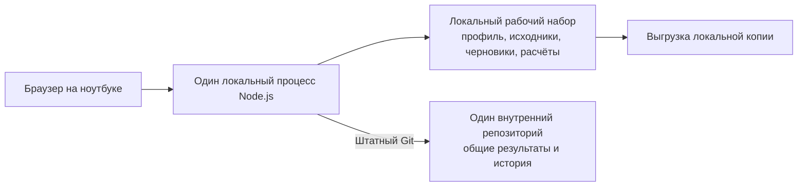
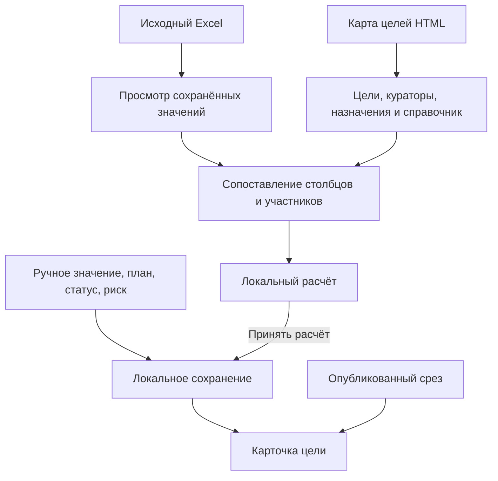
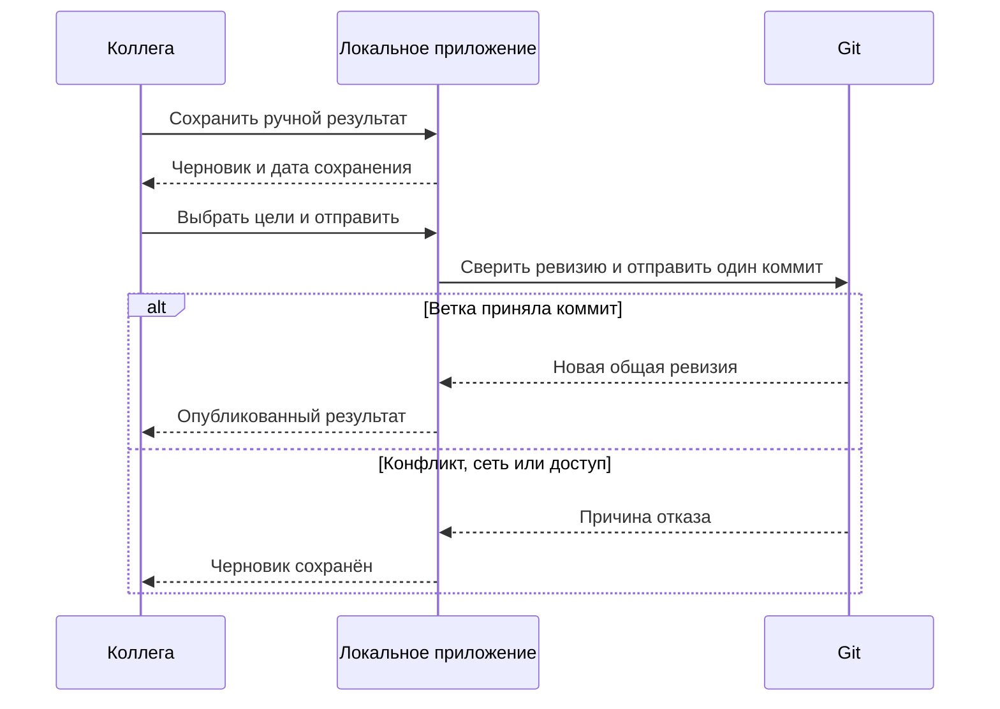

# Архитектура рабочего места УОР

Основа проекта — расшифровка от 12 ноября 2026 года. Места принятия решений: 03:53–05:54 о карте и справочниках, 06:41–15:30 об общем репозитории, 16:57–25:41 об исходниках и автоматизации, 29:18–31:40 о публикации, 33:11–34:38 об отдельных страницах отчёта и визуализации.

## Что запускается на ноутбуке

Приложение слушает адрес рабочего компьютера `127.0.0.1`. Работа с картой и источниками доступна после запуска без репозитория. Профиль содержит ФИО, тему и параметры подключения. Git пользуется установленным корпоративным способом входа. У приложения нет собственных ролей, паролей и форм входа в корпоративные системы. При чтении данных из Git обновляется только общий срез. Код приложения выпускается отдельно.

Локальные записи сохраняются последовательно и атомарно в JSON. Состояние доступно для просмотра и выгрузки. XLSX и HTML хранятся в исходном виде. Сервер отдаёт таблицы как значения и читает встроенные данные карты без выполнения скриптов. Для каждого источника доступны имя файла, время загрузки и ссылка на оригинал.

Правки описания, порога, методики и кураторов хранятся поверх исходной карты. Правки справочника также локальны. Для полной детализации коллеги загружают ту же карту. Начальный обмен через Git передаёт результаты и историю выбранных целей.

## Откуда берётся результат цели

Результат относится к цели, участнику и периоду. Храним дату факта отдельно от времени сохранения и публикации. Локальный расчёт и принятый общий результат видны одновременно. Одинаковый процент может обозначать разные вещи. В презентации зрелости 56/58 — команды в цели, 271/273 — выполненные применимые метрики. В Excel прогресс к плану 80% может быть 125% при факте 100%. Первый автоматический профиль переносит явно сопоставленный процент из подготовленной таблицы. Для воспроизведения методики зрелости нужны исходные строки по командам и метрикам. PPTX содержит контрольные итоги.

Следующие адаптеры проходят через тот же контракт таблицы: записанная выгрузка ОКО, подтверждённый формат Навигатора, версионные расчёты отдельных целей. Успех каждого этапа проверяется на эталонном входе. Синхронизация общего среза читает данные JSON. Код методик поставляется с приложением и проверяется отдельно.

## Как работают сохранение и отправка

В Git публикуются выбранные результаты. При изменении той же строки после начала локальной правки приложение требует сверить её с новой общей версией. Фоновая проверка запускается при старте и с заданным интервалом. История показывает номер общей ревизии, автора и изменённые цели. Права чтения и прямой записи в выбранную ветку проверяются на корпоративном репозитории.

## Порядок работы

1. Один запуск, импорт действующей карты и просмотр настоящего Excel. Профиль, справочник, локальные статусы и выгрузка данных.
2. Публикация выбранных целей и чтение второй установкой через отдельный тестовый репозиторий. Проверка отказа и конфликта.
3. Обновляемый расчёт из загруженной таблицы, предпросмотр и локальное принятие результата. Параметры по каждой цели.
4. Подключение корпоративного Git и проверка ОКО с рабочим браузером и исходной выгрузкой. Еженедельный отчёт и визуализация используют загруженные срезы КР.

## Как проходит новая интеграция

Приложение остаётся одним локальным процессом. У браузера отдельный адаптер запуска и политики, у операций отдельный модуль заданий, у Excel отдельный импорт. Браузерный сбор передаёт файл существующему импорту. Текст страницы поступает в локальный просмотр отчётов. Графики используют данные реестра КР и собственные настройки карточек.

Проверка Git получает данные вне очереди локальных сохранений. Предпросмотр связывает выбранные черновики с адресом, веткой и просмотренной ревизией. Перед отправкой приложение повторяет проверку. Последняя успешная общая версия остаётся доступной при откате или исчезновении среза.

Файлы `src/workspace.mjs` и `public/app.js` ещё совмещают несколько областей. При добавлении следующих интеграций команды публикации, настройки визуализации и управление экранами стоит вынести в предметные модули. Тесты проверяют вход и выход этих областей через обычные команды и HTTP.

[Браузерные подключения](browser-connectors.md) · [Приоритеты развития](product-roadmap.md)
