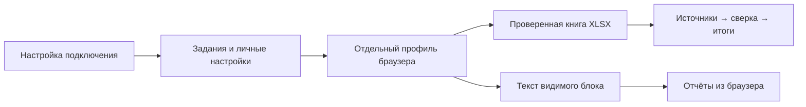

# Браузерные подключения

Рабочее место получает данные из видимого браузера. Файл XLSX поступает в «Источники», а текст выбранного блока страницы в «Итоги → Отчёты из браузера». Повторное получение текста обновляет последний успешный отчёт подключения. Сбой оставляет предыдущий результат доступным.

## Запуск на рабочем компьютере

Для браузерного подключения нужны установленный СберБраузер и Playwright, доступный Node.js. Если Playwright уже установлен отдельно, можно указать абсолютный путь к пакету. В PowerShell это выглядит так.

```powershell
$env:RM_UOR_PLAYWRIGHT = 'C:\путь\к\node_modules\playwright'
$env:RM_UOR_BROWSER = 'C:\путь\к\sberbrowser.exe'
node src/server.mjs
```

Путь к браузеру также можно указать для подключения в интерфейсе. Проверку совместимости корпоративного браузера и его входа проводят на целевом ноутбуке.

## Получение данных

1. Откройте «Настройка → Браузерные подключения» и добавьте название и HTTPS-адрес отчёта. Если сайт использует отдельный адрес входа, добавьте его origin в список. Указывайте схему, имя сайта и порт, если он нестандартный.
2. Нажмите «Открыть окно входа». Введите учётные данные в браузере. Когда сайт откроет отчёт, вернитесь в рабочее место и запустите получение из открытой сессии.
3. Для XLSX нажмите «Получить XLSX». В ручном режиме нажмите кнопку выгрузки в открывшемся окне. Для повторяемой выгрузки задайте селектор кнопки и при необходимости шаги перед ним. Приложение импортирует успешно прочитанную книгу.
4. Для текста укажите селектор, который появляется после готовности отчёта, и отдельный видимый блок с данными. Нажмите «Прочитать отчёт». Текст сохраняется в локальном просмотре вместе со временем получения.

### Еженедельная сводка СберТрека

Создайте подключение на страницу каждого куратора и заполните поле «Куратор УОР». В блок чтения включите заголовок с диапазоном, например `10.10.2026 - 17.10.2026`, и разделы «Достижения», «Требует внимания», «Планы» и «Инсайты». Одно чтение может сохранить несколько датированных недель. Сводка открывается в «Итоги → Еженедельный отчёт», календарная неделя определяется по дате окончания диапазона.

### Запись и обмен сценариями

Откройте окно входа и дождитесь страницы отчёта. На карточке подключения нажмите «Записать клики», пройдите нужные шаги в окне отчёта и завершите запись. Сохранённые шаги можно выгрузить в JSON или открыть в настройках подключения для проверки. Если кнопка скачивания записалась как обычный клик, перенесите её селектор в поле скачивания.

На другом рабочем месте откройте настройки своего подключения и загрузите JSON в разделе сценария. Проверьте шаги и сохраните подключение. В файле передаются селекторы кликов, ожиданий и кнопки скачивания. Адрес отчёта и вход каждый пользователь настраивает у себя.

Шаги сценария выполняются на странице отчёта. Доступны `click`, `wait` и `fill` для обычных фильтров. Пример использует условные селекторы, их нужно заменить после проверки конкретной страницы.

```text
click #open-filters
fill #period => Q4 2026
wait #ready
```

Текущий модуль работает с одним окном и одним выбранным блоком текста. После попытки получить данные окно закрывается. Если вход ещё открыт на отдельном разрешённом сайте SSO, окно остаётся открытым. Для многовкладочного входа, отчётов внутри iframe и записи действий нужно отдельно проверить и расширить сценарий.

## Границы модулей



Модуль заданий хранит настройки и текст отчётов под `.local/browser`. Браузерный модуль открывает личный профиль, контролирует адреса запросов, переходов и WebSocket, ограничивает время и размер выгрузки. Защита Chromium и проверка TLS включены. Оригинал успешно импортированной книги хранится у обычных источников. Профили, параметры подключения и текст отчёта остаются вне бизнес-резервной копии и Git-публикации.
