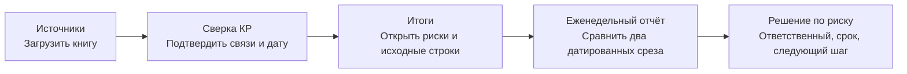

# Приоритеты развития рабочего места УОР

Независимые обзоры охватили архитектуру, сохранность данных, путь руководителя и куратора, интерфейс и доступность, использование на совещании и проверку реальных источников. Оценка опирается на действующий код, реестр Q4/Y26, карту и пакет ОС ДИТ OPS. Сценарий ниже задаёт порядок следующих работ.

## 1. Сохранность работы и выпуск

- Вынести ожидание Git из очереди локальных записей. Применять полученный срез после повторной проверки выбранного подключения. При проверке с задержкой Git куратор сохраняет черновик, перезапускает приложение и видит сохранённую правку.
- Удерживать последний проверенный общий срез при исчезновении файла или откате ветки. Выводить причину и требовать сверки перед выпуском. После отката версии 2 пользователь всё ещё должен видеть версию 2 и получать понятное сообщение.
- Показывать точный состав публикации, адрес и ветку. Проверять, что отправляется именно просмотренный набор. Изменение черновика во второй вкладке требует обновить предпросмотр и сохраняет оба черновика.

## 2. Путь пользователя

- Руководитель открывает период, находит риск и исходную строку Excel. Контрольный срез Q4 содержит 6 КР с рисками и 8 без методики. Для проверки попросить коллегу найти конкретный риск и его источник за минуту.
- Куратор загружает книгу, видит число распознанных строк и очередь сверки, подтверждает связь и дату, затем открывает тот же КР в итогах. Сохранять цель, период и руководителя при переходах между экранами. Беречь введённые поля при смене контекста.
- На телефоне сначала показывать КР, руководителя и прогноз. Детали открываются с исходной строкой. Проверять клавиатурой меню, фильтры и переход в карточку. Цвет сопровождать подписью статуса.

## 3. Достоверность и отчётность

- Отдельно показывать факт, прогресс к плану, прогноз, локальный расчёт и опубликованное значение. Для модели зрелости 56/58 относится к командам, 271/273 к метрикам, а 125% в Excel к выполнению плана 80 при факте 100.
- Сохранять происхождение принятого расчёта, включая книгу, лист и ячейку. Повторный расчёт с другим правилом сохраняет ссылку у принятого результата.
- Добавить к риску простое поручение с ответственным, сроком и следующим действием. Проверить весь путь от риска в отчёте до поручения в следующей повестке.
- Поддержать восстановление копии в новую установку с проверкой контрольных сумм. Восстановление должно возвращать черновики, настройки расчёта и исходные файлы без сети.

## 4. Рабочая проверка обмена и ОКО

Проверить один полный выпуск на разрешённой корпоративной ветке с двумя рабочими местами. Коллега получает ту же версию и понятные названия участников. Затем подключить одну выгрузку ОКО и сверить результат с контрольным файлом. Решения о дополнительных адаптерах и выгрузке презентаций принять по результатам этих сценариев.
