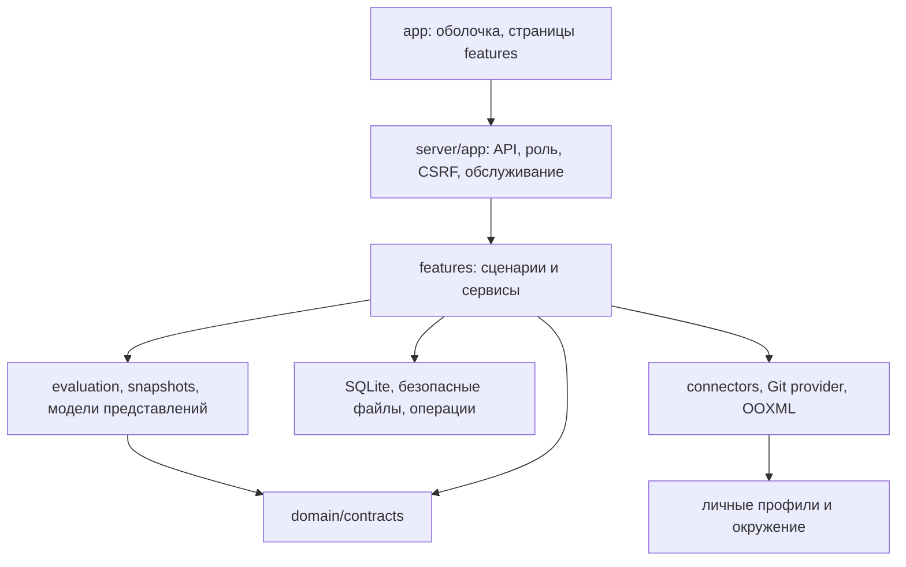

# Карта модулей и точек расширения

Документ для GigaCode / AI-PDLC. Сверен с исходным кодом 25.10.2026. Это карта существующего приложения, а не обещание универсальной платформы. Актуальные версии форматов находятся в `src/domain/app-version.ts`; средовая приёмка и известные ограничения — в [remaining-work](../remaining-work.md). Начало работы агента — [START_HERE](../agents/START_HERE.md).

## Устройство приложения

Приложение — локальный модульный монолит: React/TypeScript в браузере, Fastify на `127.0.0.1`, SQLite и файлы в приватной `.runtime`, намеренно опубликованные общие данные в Git. Отдельного удалённого API или сервиса сбора нет. Границы модулей заданы файлами, контрактами и тестами; отдельного механизма загрузки плагинов и автоматического контроля направлений импортов пока нет.

Рекомендуемое направление для нового кода: страница → маршрут → сервис сценария → чистая модель / адаптер / хранилище. Чистая модель принимает значения и возвращает результат; она не должна читать `.runtime`, сессию, сеть или изменять подтверждения. Не переносить HTTP, Git, Excel и OOXML в расчёт цели.

## Базовые слои

| Слой | Реальные точки входа | Назначение и граница |
|---|---|---|
| Общая модель | `src/domain/contracts.ts`: `Goal`, `GoalMeasurement`, `Assignment`, `SourceDefinition`, `SourceCollection`, `Observation`, `LocalSnapshot`, `SnapshotEvaluationBasis`, `EvaluationInput`, `Evaluation`, `Attestation`, `Draft`, `WorkspaceState` | Общие типы. Специфичные модели страницы или экспорта держать рядом с feature. |
| Версии | `src/domain/app-version.ts`: `APP_VERSION`, `STORAGE_SCHEMA_VERSION`, `RELEASE_FORMAT_VERSION` | Версия приложения, схема SQLite и формат выпуска — разные величины. |
| Расчёт | `features/evaluation/evaluate.ts`: `evaluateGoal`, `validateAchievement`; `measurement.ts`: `evaluateMeasurement`, `measurementRules`; `normalize.ts`: `normalizeObservations`; `fingerprint.ts`: `evaluationFingerprint` | Расчёт и точная идентичность результата. Нет роли, сети и БД. Методики валидирует `measurement-schema.ts`. |
| Выбор факта | `features/snapshots/select-facts.ts`: `selectFacts`, `snapshotFreshness`, `snapshotBusinessDate` | Один подходящий неизменяемый срез на источник/период. Повторная загрузка старого периода не делает его свежим. |
| Композиция | `server/app.ts`: `createApp`; `server/workspace/context.ts`: `createContext`, `ApplicationContext`; `server/main.ts` | Сборка зависимостей и маршрутов, локальный доступ, CSRF, общая проверка роли, остановка и закрытие. |
| Хранилище | `server/storage/database.ts`: `LocalDatabase`; `server/workspace/paths.ts`: `resolveWorkspace`, `safeArtifactPath` | SQLite хранит JSON в `records(namespace,id,value)`. `get/list/set/remove/clear` не заменяют валидацию домена. `transaction` синхронна. |
| Операции | `server/operations/operation-store.ts`: `OperationStore`; `features/sources/update-runner.ts`: `runUpdate` и `UpdateDependencies`; `update-planner.ts`: `planUpdate` | Стадии, отмена, частичный результат и восстановление прерванных действий. `UpdateDependencies` уже позволяет подменять I/O в тесте. |
| Доступ | `features/identity/permissions.ts`: `canViewWorkspacePage`, `canManageWorkspace`, `requiresCuratorForApi`, `capabilitiesForRole`; `role-service.ts`: `RoleService`, `ActionError`; `reader-projection.ts`: `readerCatalog`, `readerSnapshot`, `readerChange` | Серверная авторизация и выдача безопасных данных; видимость кнопки сама по себе не защищает API. |
| Оболочка | `app/App.tsx`: `App`; `app/Sidebar.tsx`: `Sidebar`; `app/AppContext.tsx`: `WorkspaceContext`, `useWorkspace`, `useDialog` | Выбор страницы, загрузка общего состояния, сообщения, диалоги. `preferences/useLocalPreference.ts` — личные настройки. |

`ApplicationContext.state()` и `evaluations()` обслуживают **текущее** состояние: они могут инвалидировать подтверждения и записывать `last-evaluations`. Для исторического отчёта или прогноза нельзя подставить старые факты в этот путь. Использовать чистый `buildReport()` либо исторический сервис, описанные ниже.

## Модули предметных сценариев

Все пути в таблице относительно `src/features/`.

| Модуль | Контракт / сервис / UI | Повторное использование |
|---|---|---|
| Каталог и состав | `catalog/catalog-store.ts`: `CatalogStore.readForSession`, `saveDraft`, `recordChange`, `applyDraft`; `catalog/assignment-scope.ts`: `saveAssignmentScope`; `catalog/directions.ts`; `goal-setup/goal-setup-service.ts`: `previewGoalSetup`, `commitGoalSetup` | Сначала локальный черновик, затем выбранная публикация. Изменение состава сохраняет справочники и назначение атомарно. |
| Лидеры и знания | `leaders/leader-service.ts`: `saveLeader`; `knowledge/knowledge-service.ts`: `listKnowledge`, `saveKnowledge`, `archiveKnowledge`; `knowledge/knowledge-schema.ts` | Полные имена, явные ссылки, архивирование и aliases. Не создавать вторую таблицу лидеров в новом отчёте. |
| Планы | `planning/plan-service.ts`, `plan-schema.ts`, `plan-routes.ts`; `planning-model.ts`: `buildPlanningModel`, `moscowToday`; `PlanningPage.tsx` | Обязательство, прогноз, следующая проверка и действие сохраняются отдельно от наблюдений. |
| Исполнение | `execution/execution-service.ts`, `execution-schema.ts`, `execution-routes.ts`; `execution-model.ts`: `assertDependencyGraph`, `buildBurndown`, `forecastGoal`, `retentionStatus`, `weightedAchievement` | Вехи, DAG, базовый план, история завершения и удержание. `readWorkPackage` из `execution-schema.ts` восстанавливает полную историю при переданном каталоге сегментов. |
| Журнал исполнения | `execution/execution-journal.ts`: `readExecutionJournal`, `readJournalEntries`, `rotateExecutionJournal`, `assertEntryOrder` | Неизменяемые связанные `execution_journal` внутри `catalog.entities`. Архивный сегмент проверяется по hash/id/revision и связям. |
| Обзор и директор | `overview/overview-model.ts`; `overview/portfolio-model.ts`: `buildPortfolioModel`; `director/director-model.ts`: `buildDirectorModel`; `director/decision-service.ts` | Проекции целей/назначений, полные имена, отдельные виды сроков и решения. Весовой результат брать из `weightedAchievement`, а не усреднять проценты разных целей. |
| История | `history/history-service.ts`: `getGoalHistory`; `history/history-contracts.ts`: `GoalHistory`, `GoalHistoryPoint` | Чтение периодов, сопоставимость, исторические имена, ревизии. Сервис не вызывает текущий пересчёт. |
| Недельные сводки кураторов | `weekly-report/contracts.ts`: `weeklyBriefSaveSchema`, `readWeeklyBrief`, `getWeeklyBriefs`, `validateWeeklyBriefEntities`, `currentWeekStart`, `weekEnd`, `WeeklyReportView`; `service.ts`: `listWeeklyReports`, `saveWeeklyBrief`; `routes.ts`: `registerWeeklyReportRoutes`; `WeeklyReportPage.tsx`: `WeeklyReportPage` | Объявленный текст `weekly_brief` в `catalog.entities`, один куратор/неделя, revision/CAS, личный черновик и выбранная публикация. Читатель видит только общий каталог; чужие частные недели не раскрываются. Сводка не создаёт измеренный факт или подтверждение. |
| Доказательства | `evidence/evidence-service.ts`: `listEvidence`, `readEvidenceBytes`, `prepareEvidenceBundle`, `validateEvidenceBundle`, `stageEvidenceBundle`; `evidence-routes.ts`: `registerEvidenceLibraryRoutes` | Проверенные байты по id/hash/размеру, доступ по владельцу/установке/классификации, безопасная выдача attachment. |

## Получение и принятие фактов

Рабочая цепочка: `SourceDefinition.collection` → личный профиль → реальная загрузка bytes → парсер и явный mapping → `Observation[]` → полная проверка и повторная проверка базы → принятие `LocalSnapshot`. Ошибка, отмена или неполная выгрузка не заменяют предыдущие факты.

| Участок | Точные экспорты | Контракт |
|---|---|---|
| Общий запуск | `connectors/service.ts`: `collectConfiguredSource(context, session, sourceId, signal, onStage?)` | Возвращает `{snapshots, duplicate}`. Проверяет настройки и методику после I/O, сохраняет оригинал приватно, принимает кандидатов одной синхронной транзакцией. |
| Формат конфигурации | `connectors/contracts.ts`: `collectionSchema`, `privateProfileSchema`, `scenarioSchema`, `stepSchema`, `ConnectorError`, `connectorError`; `domain/contracts.ts`: `SourceCollection` | Поддержанные adapter: `http`, `confluence`, `qlik`, `browser`; format: `observations-json`, `csv`, `xlsx`. Секреты — ссылки на переменные окружения в личном профиле. |
| HTTP и ограничения | `connectors/transport.ts`: `download`, `checkedUrl`, `loadProfile`, `profileHeaders`, `tlsOptions`, `withProfileQueue`, `Downloaded` | `{bytes: Buffer, name: string, contentType: string}`; точные origins, проверяемый TLS, конечные размер/время/повторы, отмена. |
| Специализированный сбор | `connectors/qlik.ts`: `collectQlik`; `connectors/browser.ts`: `executeBrowser`, `openBrowser`, `startRecording`, `finishRecording`, `stopAllRecordings` | Qlik получает реальные export bytes. Browser возвращает скачанный файл; recorder — только поддержанные декларативные действия после признака входа. |
| Парсинг | `connectors/service.ts`: `parseObservationsJson`, `mapSavedTable`, `factsHash`; `tabular-import/parser.ts`: `parseTable`; `importing/maturity-parser.ts`: `parseMaturityWorkbook`, `checkArchive` | Парсер не исполняет формулы/макросы и не придумывает goal/metric/participant IDs. `mapSavedTable` использует сохранённый профиль `tabular-v1` или `maturity-xlsx-v1`. |
| Ручной импорт | `tabular-import/service.ts`: `probeTabularImport`, `previewTabularImport`, `commitTabularImport`; `importing/import-service.ts`: `previewMaturityImport`, `commitMaturityImport` | Preview не является фактом. Commit проверяет владельца, срок preview, текущую подпись каталога/базового факта и идемпотентность. |
| Историческая основа | `reporting/evaluation-basis.ts`: `captureEvaluationBasis`, `evaluationScope`, `historicalRules` | При принятии сохраняются цель, методика, назначения и организация. В импорте основа готовится в preview и принимается только после проверки неизменности каталога; в сборщике проверяется до транзакции. |
| Видимость | `connectors/service.ts`: `canReadSnapshot` | Учитывает installation identity, legacy session ownership. Это не разрешение публиковать данные. |

В `sources/source-adapter.ts` есть `SourceAdapter` с `check()` и `collect(): AsyncIterable<SourceEvent>`, а также `UnconfiguredSourceAdapter`. Это прежний/ограниченный контракт и диагностика ненастроенного источника. Реальный production dispatch находится в `collectConfiguredSource()`. Добавление класса `SourceAdapter` само по себе не подключает новый сборщик.

**Новый источник при существующем способе загрузки:** настроить декларацию, личный профиль и mapping; новый код обычно не нужен. **Новый протокол:** реализовать получение `Downloaded` рядом с `qlik.ts`, расширить тип `SourceCollection`, `collectionSchema`, редактор `ConnectorPage.tsx` и dispatch `collectConfiguredSource()`. Сохранить общий pipeline парсинга/валидации/принятия. Если протоколу нужны новые приватные параметры, расширить `privateProfileSchema` и `PrivateProfileEditor.tsx`; не добавлять значения секретов в общую схему.

## Отчёты, общий OOXML и пресет зрелости

Слои уже отделены: историческая модель отчёта → сохранённый снимок → формат экспорта → конкретный PPTX. Повторное использование должно идти в этом направлении.

| Уровень | Файл / экспорт | Что расширять |
|---|---|---|
| Общая модель | `reporting/report-contracts.ts`: `ReportSelection`, `ReportRow`, `ReportComparison`, `ReportSnapshot`, `reportStatus`, `reportNumber`, `reportOfficialTarget` | Контракт отчёта не зависит от DOM/PPTX shapes. |
| Построение | `reporting/report-service.ts`: `reportSelectionSchema`, `buildReport`, `generateReport`, `readReport`, `readFrozenTemplatePptx` | `buildReport` не пишет БД и не меняет подтверждения. Строит строки по выбранным периодам и basis; числовая delta возможна только при сопоставимом cohort. `generateReport` сохраняет снимок и выбранные bytes/profile. |
| Общий экспорт | `reporting/report-export.ts`: `reportHtml`, `reportPptx`, `weeklyText`, `paginate`, `textPages` | Общие HTML/печать и сгенерированный PPTX. Недельное сравнение уже находится в `ReportSnapshot.comparison`; новый экран не должен рассчитывать его иначе. |
| Сохранённый выбор | `reporting/report-profile-schema.ts`, `report-profile-service.ts`: `saveReportProfile` | Набор целей/лидеров/периодов/шаблона хранится как `report_profile` в каталоге, с проверкой revision. |
| OOXML-контракт | `report-templates/contracts.ts`: `TemplateProfile`, `TemplateField`, `StoredReportTemplate`, `ReportTemplateBundle`, `templateProfileSchema`, `templateBundleSchema` | Поддержаны text/table bindings, repeats и один именованный preset. Неизвестные kinds отклоняются строгой схемой. |
| OOXML-движок | `report-templates/ooxml.ts`: `inspectTemplate`, `checkTemplate`, `assertTemplateCoverage`, `renderTemplate`, `validateZipEnvelope`, `TEMPLATE_LIMITS` | Проверка архива и shapes; подстановка известных полей, повтор/продолжение. Сохраняет статические части исходного PPTX, не превращает их в динамические данные. |
| Владение шаблонами | `report-templates/service.ts`: `saveReportTemplate`, `getReportTemplate`, `listReportTemplates`, `inspectUploadedTemplate`, `validateTemplateBundle`, `storeValidatedTemplateBundle`, `exportTemplateBundle` | Личные и общие слоты раздельны. Проверка архива до атомарной записи; CAS revision. Перед публикацией — явный выбор шаблона. |
| Пресет зрелости | `report-templates/maturity-preset.ts`: `recognizeMaturityTemplate`, `suggestedMaturityProfile`; `maturity-render.ts`: `renderMaturityTemplate`; `MaturityPresetEditor.tsx` | Распознавание структуры, явный выбор goal/metrics/leader order и рендер конкретного шаблона `dit-maturity-v1`. Имя файла не является идентичностью шаблона. |
| Данные зрелости | `reporting/maturity-contracts.ts`: `maturityReportSchema`, `MaturityReportData`; `maturity-data.ts`: `buildMaturityReport`, `maturityStats` | Замороженные расчёты команд/метрик/лидеров, сравнимый baseline и отдельная цель. Renderer получает эти данные, не обращается к текущему каталогу. |

**Обычный новый шаблон:** использовать `TemplateManager.tsx`, инспекцию и поддержанные text/table/repeat bindings. Для нового поля расширить `templateFieldSchema`, разрешение значения в `ooxml.ts` и UI выбора, затем проверить покрытие всех выбранных целей/лидеров. Обычно новый preset не нужен.

**Новый специальный preset:** добавить отдельную строгую схему с новым `kind`, распознавание структуры, замороженный payload и renderer. Сейчас `checkTemplate`, `assertTemplateCoverage`, `renderTemplate`, `generateReport`, `TemplateManager.tsx` и `MaturityPresetEditor.tsx` знают один пресет; их нужно расширять явно. Новый payload должен валидироваться при переносе в `workspace-maintenance/bundle-service.ts`. Не использовать универсальное `if (profile.preset)` как доказательство, что любой будущий preset является зрелостью. Реестра пресетов в runtime пока нет; выделять небольшой реестр оправданно при появлении второго специального пресета, а не до конкретного требования.

`templatePackage` из `ooxml.ts` экспортирует низкоуровневые функции для специального renderer. Это внутренняя точка совместной разработки, не стабильный внешний SDK. Проверка ZIP/XML не подтверждает визуальную пригодность: нужен рендер и просмотр в целевом Office, особенно для длинных названий, пустых и максимальных наборов.

## Публикация, файлы и жизненный цикл

| Контур | Файлы / экспорты | Обязательное условие расширения |
|---|---|---|
| Выпуск куратора | `release/release-service.ts`: `previewRelease`, `validateReleasePreview`, `resolveReleaseConflict`; `release-contracts.ts`: `ReleasePreview`, `PublicationSelection` | Выбор состава, подпись локальных черновиков, ожидаемый remote commit, явные решения конфликтов. Preview устаревает при изменениях. |
| Передача через Git | `publishing/application-publishing.ts`: `publishChanges`, `syncPublished`, `checkRemoteUpdates`, `createGitProvider`; `git-cli-provider.ts`: `GitCliProvider`, `mergeContent`, `assertPublicationPath` | `release/current` готовится кураторами, `main` выпускает руководитель. Никаких force-push/reset для чужих изменений. Хост и ветки — из конфигурации. |
| Merge и проверка | `publishing/merge-object.ts`: `canonicalJson`, `inspectMerge`, `mergeObject`; `validate-version.ts`: `validateCatalog`, `validateSnapshot`, `validateEvaluationBasis`, `validateAttestation`, `validateChangeEvent`; `snapshots/publication-package.ts`: `preparePublication` | Изменения независимых полей объединяются; конфликтующие требуют выбора. Demo-only не допускает corporate. Новая сущность требует проверки и безопасного пути. |
| Совместимость | `system/compatibility.ts`: `createReleaseManifest`, `assertCompatibleRelease`; `catalog/local-release.ts`: `readLocalRelease` | Новый опубликованный формат требует явной совместимости и проверки старой версии; наличие нового UI не всегда требует новой версии storage. |
| SQLite-копии | `system/backup-service.ts`: `createBackup`, `listBackups`, `restoreBackup`, `migrateStorage`, `pruneBackups`; `system-routes.ts`: `withMaintenance` | Проверить hash, SQLite integrity, фактический marker и доменные данные; хранить исходную БД до полного успеха и санитарной обработки. |
| Перенос рабочего набора | `workspace-maintenance/bundle-service.ts`: `exportWorkspaceBundle`, `validateWorkspaceBundle`, `previewWorkspaceRestore`, `restoreWorkspaceBundle`, `archivedReportBytes` | Явный список namespaces, проверка ссылок/байтов/hash/классификации. Сессии, профили доступа, сертификаты, реестр паролей исключены. Перенесённые отчёты становятся архивными. |
| Хранение | `workspace-maintenance/storage-service.ts`: `previewStorageCleanup`, `quarantineStorageItems`, `restoreQuarantinedItem`, `purgeQuarantinedItems`; `recovery.ts`: `recoverWorkspaceMaintenance` | Защищать ссылки и актуальные периоды; сначала обратимый карантин. Восстановить незавершённый журнал до чтения imports при запуске. |
| Обновление кода | `system/code-update.ts`: `registerCodeUpdateRoutes`, `prepareLocalCodeUpdate`, `activateLocalCodeUpdate`; `scripts/dev.mjs`, `scripts/code-update-runtime.mjs`, `config/update-protocol.json` | Отдельно от выпуска данных: staging code/dependencies, quiesce, ff-only, durable commitpoint, затем открытие записи. После commitpoint нельзя откатывать новые принятые данные. |
| Пустая установка | `scripts/workspace-bootstrap.mjs`: `emptyCatalog`, `setupWorkspace`; `scripts/setup-workspace.mjs`; `config/curators.example.json`; `scripts/provision-curators-file.ts`: `provisionFromFile` | `setup:workspace -- --mode empty` создаёт новую установку без рабочих данных; demo выбирается явно. Существующая установка не перезаписывается. Публичный пример содержит только placeholder, локальный input и hash registry — приватны. |
| Чистая поставка кода | `scripts/clean-distribution.mjs`: `exportCleanDistribution`; `scripts/export-clean.mjs` | Только clean tracked HEAD: allowlisted код/текущие документы, исходный проверенный или сгенерированный пустой каталог (`generatedBaseline`), manifest с commit/version/хешами. Выход не следует ссылкам и не перезаписывает файл. `--with-local-accounts` создаёт отдельный PRIVATE ZIP только проверенного hash registry; публичный ZIP остаётся без учётных записей. |
| Архив локального видимого журнала | `scripts/local-history.ts`: `archiveLocalHistory`; `scripts/archive-local-history.ts` | Отдельная команда при остановленном приложении. Создаёт проверяемую полную SQLite-копию и архив журнала; доменные факты, подтверждения, черновики и учётные записи сохраняются. Это не очистка истории Git и не удаление журнала исполнения цели. |

Для нового namespace решение о хранении должно быть явным: приватный или общий, владелец/установка, schema validation, публикация, перенос, restore sanitation, ссылки для retention. `LocalDatabase.set()` ничего из этого автоматически не обеспечивает. Не добавлять namespace в перенос только потому, что он существует в БД. Если новая feature использует уже типизированную `KnowledgeEntity`, проверить `validateCatalog`, универсальные entity-маршруты, историю, release и перенос; не давать универсальному редактору изменять `execution_journal`.

## Существующие связи, которые стоит улучшать адресно

| Наблюдение в коде | Практический риск | Минимальное обоснованное продолжение |
|---|---|---|
| `ApplicationContext` одновременно держит БД/роли/операции, собирает state и применяет текущие инвалидации | Новый отчёт случайно вызывает мутацию через удобный `state()` | Для отчётных features брать `buildReport` и узкие read-only входы. Выделять отдельный current-evaluation command при изменении этого сценария, не переписывать весь context ради документации. |
| Ожидаемый состав и правила scope собираются в context, history, reporting и импортных preview | Разные экраны могут начать по-разному понимать полноту или fingerprint | При следующем изменении методики выделить чистый builder входа оценки и проверить равенство результатов preview/current/history/report на общей синтетической матрице. Сохранить различия current/historical и уже выданные fingerprints. |
| `captureEvaluationBasis` находится в reporting, но нужен import/connectors/manual acceptance | Слой приёма фактов зависит по имени от экспортного модуля | При затрагивании этой области перенести основу в нейтральный snapshots/evaluation модуль, сохранив re-export и без изменения payload/хеша. Сейчас переезд не нужен для запуска. |
| `canReadSnapshot` находится в connector service и импортируется context/reporting/history/publishing | Простая policy подтягивает модуль сбора | При следующем изменении политики вынести чистую функцию в snapshots/identity, сохранив сигнатуру и тесты installation/legacy ownership. |
| Типы SourceCollection, Zod schema, редактор и dispatch перечисляют adapter вручную | Можно добавить протокол только в одном месте | Менять перечисленные точки одним PR и тестировать реальное принятие. Registry вводить при росте числа протоколов, сохраняя строгие схемы и общий accept pipeline. |
| Пресет задаётся в profile, report model, OOXML и переносе | Новый preset ошибочно обрабатывается как `dit-maturity-v1` | Для второго preset добавить явный dispatch по `kind` во всех точках; registry может объединить распознавание/validation/render без доступа renderer к текущему состоянию. |
| Навигация перечислена в `App.tsx`, группах `Sidebar.tsx` и `permissions.ts` | Страница существует, но отсутствует в меню либо доступна неправильной роли | Проверять все три места. Небольшой общий metadata-каталог полезен при следующем расширении меню, без переноса server policy в React. |
| SQLite хранит общий JSON, schemas распределены по feature и transfer/publishing | Новая запись работает локально, но теряется при переносе или не валидируется на входе | Для каждой новой сущности описать lifecycle и расширить адресные validators/tests. Полный ORM или микросервисы из этого не следуют. |

Эти пункты — рекомендации по дальнейшей разработке, а не выполненные рефакторинги и не блокировка корпоративной настройки. Приоритет — устранение расхождений доменного смысла; перенос файлов ради формы не приносит самостоятельной пользы.

## Проверки по границам

Отдельный личный интерфейс ОКО: `src/app/oko` и `features/connectors/workbench` → существующий workbench v1 transport → `workbench-workflow-module/service/store`. Сборка — `oko-application.ts`, запуск — `scripts/oko.ts`; legacy entry остаётся прежним. Сервис связывает управляемый браузер, чистый tabular parser/normalizer/enrichment и приватные результаты с проверкой ownership/hash. Временный режим reader/editor владеет только local preview, состояние не считается verified registry. См. [пользовательский путь](../OKO_WORKFLOW.md).

Файловый приём новой модели: `features/tabular-import/workbench-import.ts` регистрирует собственные async `import.preview` / `import.apply`; `workbench-import-store.ts` хранит приватный предпросмотр и итог выбора. Он переиспользует lossless parser, source normalizer, directory enrichment и транзакционный SourceStore. Типизированный `WorkbenchRepository.readImportFactState` читает текущие редакции по индексам factKey/scope/time и опубликованные ручные корректировки. Нет обхода namespace SQL, скрытого файлового резерва ОКО или переключения production entry. Общий мастер импорта относится к последующему T34.

| Изменение | Существующие адресные проверки |
|---|---|
| Методика/состав/fingerprint | `evaluation/evaluate.test.ts`, `evaluation/measurement.test.ts`, `snapshots/select-facts.test.ts`, `tests/integration/assignment-scope.test.ts`, `tests/integration/goal-history.test.ts` |
| Импорт/acceptance | `tabular-import/parser.test.ts`, `tabular-import/service.test.ts`, `importing/maturity-parser.test.ts`, `tests/integration/maturity-import.test.ts`, `tests/integration/snapshot-acceptance.test.ts` |
| Сбор/отмена/приватность | `connectors/connectors.test.ts`, `sources/source-adapter.test.ts`, `tests/integration/update-order.test.ts`, `identity/reader-state.test.ts`, `identity/reader-projection.test.ts` |
| Отчёт/OOXML/preset | `reporting/report-service.test.ts`, `reporting/weekly-report.test.ts`, `reporting/report-api.test.ts`, `report-templates/ooxml.test.ts`, `report-templates/maturity-template.test.ts`, UI tests ReportsPage/TemplateManager |
| Git/CAS/release | `publishing/merge-resolution.test.ts`, `publishing/validate-version.test.ts`, `release/release-service.test.ts`, `tests/integration/two-curator-publish.test.ts`, `tests/integration/application-publishing.test.ts` |
| Исполнение/журнал | `execution/execution-model.test.ts`, `execution/execution-service.test.ts`, `execution/execution-journal.test.ts`, `tests/integration/execution-plan.test.ts` |
| Недельная сводка | `weekly-report/service.test.ts`, `weekly-report/WeeklyReportPage.test.tsx`, общий validator каталога и reader/curator API |
| Restore/retention/update | `system/restore-safety.test.ts`, `system/transactional-update.test.ts`, `system/update-gate.test.ts`, `workspace-maintenance/workspace-maintenance.test.ts`, `workspace-maintenance/recovery.test.ts`, `workspace-maintenance/routes.test.ts` |
| Чистая передача/первый запуск | `system/clean-distribution.test.ts`, `system/workspace-bootstrap.test.ts`, `identity/curator-file.test.ts`: synthetic Git → ZIP → пустая установка, отказ при грязном checkout, проверка приватных границ |
| Новая страница/роли | Тест компонента feature, `app/App.roles.test.tsx`, `app/Sidebar.test.tsx`, `identity/role-policy.test.ts`, интеграционный вызов маршрута reader/curator |

Пути feature tests в таблице относительно `src/features/`; пути `tests/` и `app/` — относительно корня и `src/` соответственно. Команды и критерии передачи — в [START_HERE](../agents/START_HERE.md). Сам документ не означает новый прогон всех тестов; доказательства конкретной ревизии записываются отдельно.

T16 proposal continuation: `src/features/catalog/workbench-directory.ts` owns explicit goal→team-template draft reservations and pending cluster-team links. T17 owns their persistence, numeric-population completion and retry identity; T26 owns activation after confirmed main. The pure function neither publishes nor inherits neighboring assignment populations/deadlines.

T17: catalog/workbench-drafts.ts + workbench-draft-store.ts own private recursive partial forms, separate reference-checked frozen versions, package CAS/form audit, version-bound manual proofs and private derived calculations. Invalid intermediate forms stay in audit; no-op saves preserve immutable Headers. workbench-draft-commands.ts owns strict draft/calculation/correction/confirmation/snapshot/organization descriptors; the registry binds profiled calculations to person before replay while anonymous viewers retain published-only calculation. Evidence/workbench-evidence.ts owns private immutable proof bytes and saved-link authorization; application/routes expose the narrow binary artifact read. Core repository owns indexed published historical Evidence-artifact lookup and current manual status, keeping foreign SQL out of modules. Internal publication ports export frozen dependency chains/derived bases; T22 must authorize owner, validate readiness and carry those dependencies. Legacy entry/data remain separate until T39.

T18: execution/workbench-execution.ts owns strict work/decision/dependency commands and pure deadline/risk/dependency projection. Its trusted DraftOwnerPolicy runs inside T17 saves and package validation; workbench-execution-store.ts records private completion audit in that same transaction. Core repository supplies only confirmed published execution heads; own package overlay cannot read foreign drafts. Work completion never creates a goal fact or Attestation. Legacy execution packages/journals retain their existing reader; no schema reinterpretation or production entry switch.

T19: execution/workbench-notification-causes.ts derives real work/decision causes from the confirmed graph and composes explicit typed current-state sources with the selected published calendar/settings. workbench-notification-runtime.ts registers personal/reminder commands, refreshes own access and owns polling start/stop; createWorkbenchApp mounts that lifecycle explicitly. workbench-notifications.ts owns personal dedup/read/subscription state; workbench-reminders.ts owns Moscow recurrence. Optional goalIds route linked-work subscriptions; recurring=false keeps one-off events out of daily repeats. Future quality/Git/job producers and paged list are bound by T21/T22/T25; no provider infers a successful external state from failure.
<!-- Workbench T20: configuration owner contracts -->

`features/knowledge/workbench-fields.ts` owns configurable field commands and schema descriptions. `workbench-dashboards.ts` owns the six strict registered dashboard schemas and exact assignment/method/metric resolution, including trusted saved-basis resolution. DraftService validates owner settings before freezing and again before package readiness. `features/system/workbench-preferences.ts` owns installation-local context/sort/visual choices and backup data; preferences never grant roles or write shared definitions. Query/UI composition consumes these ports in T21 and later tasks.
