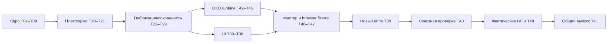

# Переработка рабочего места УОР — Implementation Plan

> **Для агента:** выполнять задачи по очереди с проверкой и коммитом. При наличии навыков используйте superpowers:subagent-driven-development или superpowers:executing-plans. Если навыков/инструментов нет, тот же план выполняется обычными файлами, Git и npm; Codex не обязателен. Галочки отмечаются только после фактической проверки.

**Goal:** реализовать согласованное локальное рабочее место УОР: цели, данные, расчёты, аналитику, исполнение, панель кураторов, Git/Bitbucket-публикацию и автоматизацию ОКО через записываемый сценарий СберБраузера.

**Architecture:** модульный монолит на существующем стеке. Новые контракты/сервисы проверяются отдельно от legacy entry, затем T39 включает новую сборку и закрывает прежние writable/auth маршруты; история и рабочая БД сохраняются. Общие данные/код приходят из main корпоративного репозитория, допуск — из отдельного закрытого hostname-реестра.

**Tech Stack:** Node.js **22.16.0**, npm **10.9.2**, Python **3.13.5** при использовании соответствующего адаптера; текущие TypeScript/React/Vite/Fastify/Zod/SQLite/Vitest/Playwright. Версии библиотек не обновляются автоматически.

**Spec:** [согласованный переносимый пакет](../specs/2026-10-28-uor-workbench/README.md), [подтверждение](../specs/2026-10-28-uor-workbench/APPROVAL.md), [дополнение про ОКО](../specs/2026-10-28-uor-workbench/21-oko-browser-scenarios.md).

## Global Constraints

1. Ветка разработки: **codex/uor-workbench-rebuild**, repository **SAleksanyaS/RM_UOR**, исходный код **3d8704e4a6ff2195af4f2c0602ed11bff5d38f4b**. Проверить branch/status до изменений; чужие изменения не стирать. RM_UOR-compat-22.16.0 параллельно не переделывать.
2. GitHub — контур разработки. Корпоративный Bitbucket в продукте — другой контур. Банковские выгрузки, hosts, cookies, профиль, credentials, private registry и реальные probe reports не публикуются в GitHub.
3. Локальные ноутбуки, около **100** сотрудников, общего прикладного сервера нет. Один основной repo плюс специальный приватный repo допуска; переключатель рабочих пространств не вводится.
4. Роли viewer/curator/chief определяет **hostname → профиль**. Bitbucket account не сопоставляется с профилем. Curator/chief имеют одинаковую панель подготовки; финальный merge — во внешнем Bitbucket.
5. Перед каждым внешним write и повтором нужен свежий gate. Git native login идёт в штатной консоли/helper, не app password form. После ожидания входа gate повторяется до передачи; commits сохраняются при отмене.
6. Reader может получить собственные факты, применить verified main, настроить личное представление и создать/восстановить свою копию. Это не право менять официальную методику/факт/статус УОР.
7. У цели один штатный источник. Для ОКО основной путь — СберБраузер + записанный сценарий; скачанный им Excel/CSV всё ещё ОКО. Manual file mode не используется скрытым резервом ошибки ОКО.
8. При отказе: последний успешный локальный набор с датой → Git при его отсутствии → «Нет данных». Ноль не подставляется. Raw, обогащение и расчёт различимы.
9. ДИТ/кластер/продукт/необязательная команда имеют свои назначения/условия; нет скрытого усреднения или требования выполнить все дочерние цели. Полнота сверяется с ожидаемым составом.
10. Новые назначения/оргсвязи действуют с публикации. Confirmed main применим без REST-времени merge; неизвестная дата явно неизвестна. Старые согласованные основания неизменяемы.
11. Пятничный график без нового наблюдения показывает старое значение с исходной датой и предупреждением. Нового измерения нет. История хранится **без ограничения срока**, автоматически ничего не удаляется.
12. Выгрузка **до 2 000 строк** одной цели — профиль нагрузки, не лимит всей истории и не причина обрезать источник.
13. Общие правки накапливаются в одном PR куратора за цикл; обновление источника/сохранение формы PR не создаёт. Цикл — важное событие либо **1–2 раза в неделю**.
14. Сроки/календарь/границы дня — **Europe/Moscow**, напоминание по умолчанию **09:00** в рабочие дни УОР. Срок до конца дня; выходной сам срок не переносит.
15. Первый выпуск — сразу для всех, без отдельного pilot. Отчёты/PPTX и произвольные новые личные сервисы — следующий этап; точки расширения есть, функциональность этого этапа не раздувать.
16. Все checks в задачах — ожидаемые результаты исполнения. Пока подготовлен план, не реализован новый runtime и не пройдены банковские проверки.

## Review Focus

- Часы продвинулись, но facts не изменились: fresh → stale/canConfirm false без нового basis/capture; T07/T21, tests quality/current projection.
- Domain commit успел, ответ потерян: тот же commandId возвращает receipt/job, не второй факт/PR; T12/T15/T24.
- Вход Git долго ждал, профиль отозван: внешний write не начинается по старому allow, коммиты сохранены; T11/T25/T36.
- Частичная выгрузка/unknown date/отсутствующий продукт: нет ложного нуля/полноты/подтверждения; T05/T15/T16/T45/T47.
- Restore в непустую базу либо failure после activation: проверенная rescue/commitpoint сохраняет более новые данные и запрещает опасный повтор; T27/T28/T38/T40.

## Как пользоваться комплектом

1. Читать этот файл и [CONTRACTS.md](2026-10-28-uor-workbench/CONTRACTS.md).
2. Открыть [PROGRESS.md](2026-10-28-uor-workbench/PROGRESS.md), найти первую доступную задачу в **порядке ниже**, а не просто минимальный номер.
3. Прочитать указанные разделы спеки и Interfaces задачи. Create — будущий файл, Modify — существующий либо созданный предыдущей задачей.
4. Выполнить цикл RED → минимальное изменение → GREEN → указанные проверки → commit → запись продолжения. Плохой baseline не выдать за новый regression, но не прятать.
5. После изменения интерфейса синхронно исправить CONTRACTS и всех потребителей; записать причину. Бизнес-ожидания ради PASS не менять.
6. Проверить [матрицу AC](2026-10-28-uor-workbench/AC-COVERAGE.md). Перед выпуском она должна иметь доказательства, а не только номера тестов.

## Части плана

| Часть | Задачи | Проверяемая поставка |
| --- | --- | --- |
| [01 — ядро](2026-10-28-uor-workbench/01-core-and-calculation.md) | T01–T09 | Схемы, точные числа, версионное хранилище, правила расчёта/оснований/истории. |
| [02 — платформа и данные](2026-10-28-uor-workbench/02-platform-data-and-api.md) | T10–T21 | Локальный API, допуск, jobs, источники/импорт, черновики, исполнение, уведомления, поля, поиск. |
| [03 — публикация и сохранность](2026-10-28-uor-workbench/03-publication-and-recovery.md) | T22–T29 | Пакет/PR, Git/Bitbucket/консоль, verified main, безопасные updates, backup/restore и мигратор. |
| [04 — интерфейс и выпуск](2026-10-28-uor-workbench/04-interface-and-release.md) | T30–T41 | Пять экранов/конструкторы, переключение entry, сквозная проверка и выпуск. |
| [05 — фактическая среда](2026-10-28-uor-workbench/05-bank-probes.md) | BP-01–BP-06 | Реальные подключения/права/источники/перенос/runtime/native auth; не выдуманные credentials/URL. |
| [06 — ОКО](2026-10-28-uor-workbench/06-oko-browser-scenarios.md) | T42–T48 | Managed СберБраузер, запись/проверка/публикация сценария, replay→download→capture и реальная проверка. |

## T00: Рабочая ветка, проверяемый baseline и вход для исполнителя

**Состояние подготовки:** ветка и этот документационный комплект создаются при планировании; проверки продукта ниже пока не запускались. Исполнитель всё равно записывает свой baseline, потому что runtime/checkout могли измениться.

**Files:** читать `AGENTS.md`, `package.json`, `package-lock.json`, approved specs/планы; вести PROGRESS. На этом шаге src/scripts не менять.

- [ ] Из корня клона выполнить:
  ```text
  git remote get-url origin
  git branch --show-current
  git status --short
  git rev-parse HEAD
  node --version
  npm --version
  python --version
  git --version
  ```
  Origin — SAleksanyaS/RM_UOR, branch — codex/uor-workbench-rebuild. Не печатать credential-bearing origin в общий отчёт. Если чужой dirty diff — сохранить и отделить, не reset/clean. Путь C:/Users/Sasha — пример текущего checkout, в другом клоне корень определяется `git rev-parse --show-toplevel`.
- [ ] Проверить Node v22.16.0/npm10.9.2. Не менять требование на удобную установленную версию. При несовпадении — BLOCKED_RUNTIME для доказательства целевой совместимости, использовать установленный разрешённый runtime/проверку BP-05; не обещать Node22 по прогону Node24. Python3.13.5 нужен только при фактическом использовании Python-адаптера, Node recorder не ждёт нового Python-worker.
- [ ] Выполнить `node docs/superpowers/plans/2026-10-28-uor-workbench/verify-plan.mjs`: ожидается PASS по20checksums/48tasks/48AC+8OC/JSON/ссылкам. Это проверка документации, не продукта. Если checksum не сходится — остановиться и установить редакцию, не пересогласовывать решения по старым чатам.
- [ ] При необходимости зависимостей выполнить `npm ci --no-audit --no-fund` (lockfile сохраняется). Не отключать TLS/CA и не обновлять версии ради установки. Доступ к registry вне среды — отдельная диагностика, не ошибка методики.
- [ ] Один baseline: `npm test`, затем `npm run build`. Записать runtime/exit/failures; это baseline старого исходного кода, не доказательство новых AC. Повторять весь прогон только после значимого объединения/нового сбоя; в задачах использовать focused tests.
- [ ] Заполнить run entry в PROGRESS: branch/commit/runtime/команды/exit/dirty files/первая задача. Не коммитить .runtime, node_modules, реальные профили, screenshots банка и сертификаты.

## Точный рекомендуемый порядок исполнения

Строгий последовательный режим по умолчанию:

```text
T00
T01 T02 T03 T04 T05 T06 T07 T08 T09
T10 T11 T12 T13 T14 T15 T16 T17 T18 T19 T20 T21
T22 T23 T24 T25 T26 T27 T28 T29
T42 T43 T44 T45
T30 T31 T32 T33 T34 T35 T36 T37 T38
T46 T47
T39 T40
BP-01 BP-02 BP-03 BP-04 BP-05 BP-06 и T48 по их входам
T41
```

Нумерация T42–T48 добавлена после уточнения ОКО; выполнять T39 до T47 нельзя. T46 расширяет SourceSetupWizard, созданный T34. BP-03 и T48 используют один согласованный реальный сценарий и общий evidence, а не два фиктивных «успеха».

Для реального provider binding обязательны результаты соответствующего BP и конкретный provider-specific subplan части05. Пустой/примерный профиль даёт not_ready/exit2. Независимые типы, parser, evaluator, UI и локальные fixture tests продолжаются; производственный выпуск T41 остаётся закрыт.



## Правила остановки и продолжения

| Ситуация | Действие |
| --- | --- |
| Focused test упал новым поведением | Остановить текущую задачу, сохранить лог, исправить её owning code; не запускать зависимого исполнителя с заглушкой. |
| Baseline уже падает | Зафиксировать исходный failure/commit; выделить влияние, не уничтожать baseline tests. Новые tests должны доказать именно новую задачу. |
| Неизвестный результат push/PR | Сверить remote/marker/revision; не новый commit/PR по повторному клику. |
| Вход/сеть/схема источника недоступны | Сохранить последнюю принятую базу/пакет; waiting_user/not_ready по контракту, не подставлять0 и не скрывать ошибку. |
| Изменился main/preview/stateRevision | Перепроверить и создать новую точную preview, не force-push и не latest-wins. |
| Восстановление не завершилось безопасно | RECOVERY_REQUIRED, запрет записи и сохранённая rescue; не очищать журнал, чтобы «запустилось». |
| Нет настоящего банковского входа/файла/версии | BP not_ready, перечислить конкретный необходимый input. Не повышать fake до bankVerified. |
| Поменялся существенный бизнес-смысл | Остановить эту развилку и запросить точное решение владельца. Технические детали внутри согласованных контрактов решать по плану самостоятельно. |

Передача другому агенту: task ID, текущий commit, файлы/diff, выполненные команды/exit, последний незавершённый шаг и следующая точная команда. Не требовать весь чат или доступ к специфическим Codex tools.

## Готовность задачи и готовность выпуска

Задача DONE только при наличии её реализации, необходимых GREEN/runtime checks, отсутствия незавершённого recovery и записи commit/evidence. Документационный placeholder или проход fake-adapter не закрывает реальное подключение.

Выпуск T41 требует всех обязательных AC/BP, принятого переноса и восстановления. Результат планирования — ещё не готовое приложение; никакой main merge/развёртывание не происходит от чтения этого плана.

## Как добавлять следующий сервис после первого выпуска

1. Описать свой entity/schema/команды/read models и ответственность хранения.
2. Зарегистрировать PlatformModule и собственные schema/query/command descriptors.
3. Подключить общие jobs, поиск, уведомления, backup/migration и UI-навигацию.
4. Добавить контрактные примеры и focused/full-path проверки, обновить инструкции.
5. Поставить в общем кодовом обновлении Git. Динамический исполняемый плагин, новая ролевая система и отдельный сервер для этого не обязательны.

Не начинать разработку следующего сервиса в рамках T01–T48 только потому, что архитектура его допускает.
