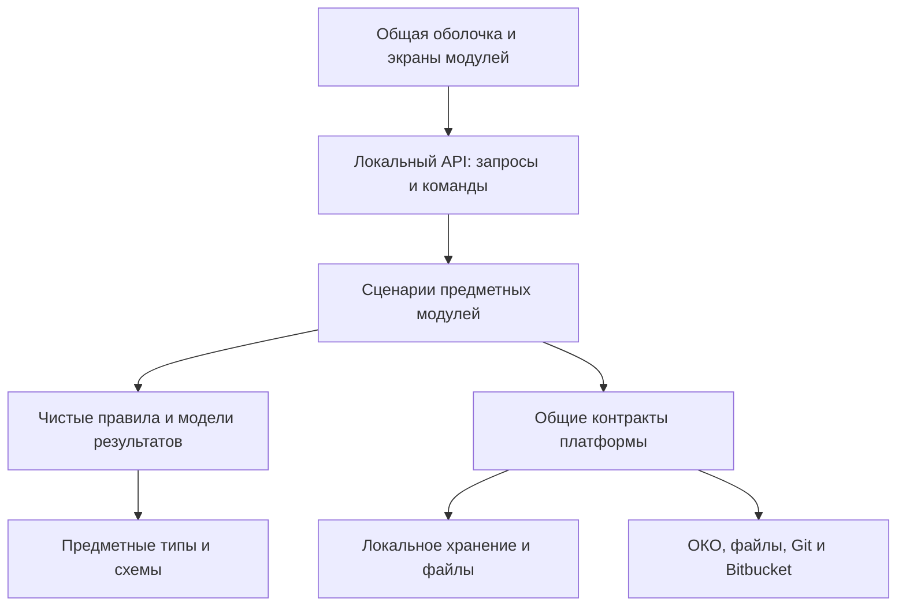

# Архитектурный каркас рабочего места УОР

Дата: 28 октября 2026 года. Статус: техническое предложение агента на основании журнала решений. Подтверждённые требования отмечены ссылками на журнал; конкретное устройство ниже не выдается за уже утверждённую полную архитектуру. Документ задаёт границы для последующих спецификаций, но ещё не является инструкцией для реализации всего проекта.

## 1. Основание и выбранный подход

В проекте **один основной репозиторий приложения** с кодом и намеренно публикуемым общим содержимым. При необходимости другой коллектив делает форк. По D-120–D-121 добавляется отдельный закрытый служебный Git-репозиторий с соответствиями hostname → человек/роль: его читает УОР, изменяет только главный УОР — пользователь. Это служебное исключение к D-110, а не несколько рабочих пространств; переключателя репозиториев в приложении нет.

Предлагается локальное модульное приложение с единой поставкой. На ноутбуке работают интерфейс в браузере и локальный прикладной процесс. Модули разделены контрактами и владением данными. Отдельный процесс допускается для конкретной интеграции, например Python-сборщика; это не добавляет общий сервер.

| Рассмотренный подход | Оценка для нашего проекта |
| --- | --- |
| Одна поставка, предметные модули и общие механизмы | Рекомендация: соответствует ноутбукам, одному основному репозиторию и общему обновлению D-097; служебный реестр имеет отдельное подключение. |
| Независимо устанавливаемые исполняемые плагины | Не требуются: пользователь выбрал общий выпуск модулей. |
| Набор удалённых микросервисов | Не соответствует текущей инфраструктуре без общего прикладного сервера. Выделение конкретного локального обработчика возможно по необходимости. |

Общий принцип разделения логики при единой поставке описан в [Microsoft Common web application architectures](https://learn.microsoft.com/en-us/dotnet/architecture/modern-web-apps-azure/common-web-application-architectures). Применяем принцип границ, а не стек .NET или Azure.

## 2. Техническая основа

Обязательные версии пользователя: **Node.js 22.16.0, npm 10.9.2, Python 3.13.5**. Предлагается сохранить из существующего RM_UOR React/TypeScript для интерфейса, Fastify для локального API, SQLite и приватные файлы для локального хранения. Это предложение развития существующего стека, а не требование пользователя о конкретных библиотеках.

Основание: `RM_UOR/package.json`, `RM_UOR/docs/architecture/module-map.md`, `RM_UOR/src/server/storage/database.ts`. Существующее хранилище использует `node:sqlite`; его API присутствует в [документации именно Node 22.16.0](https://nodejs.org/download/release/v22.16.0/docs/api/sqlite.html), где модуль имеет статус активной разработки. Доступ к нему закрывается адаптером хранения; предметные модули не зависят от прямых вызовов драйвера. Это чтение кода и документации, а не новый прогон совместимости приложения.

Python нужен там, где есть конкретный обработчик или интеграция. Общие правила целей не дублируются между Python и TypeScript. Формат входов, результатов, ошибок и отмены Python-процесса определяется отдельным контрактом.

В существующем RM_UOR Python не запускается общим launcher: loader из Blueprint является отдельным инструментом. Его подключение к новому приложению — проектируемая интеграция, а не уже готовая возможность. Точные версии зависимостей и lockfile должны проверяться на целевой связке Node/npm; этот каркас не предписывает автоматического обновления библиотек.

Локальный API слушает loopback. Локальные данные, настройки подключения, профили браузера и архивы не раздаются как статические файлы. Корпоративные подключения используют права самого сотрудника. Матрица ОС сейчас не обсуждается; совместимость проверяется на фактической среде поставки (D-101).

По D-114 на старте ожидается около 100 сотрудников. Это отдельные локальные клиенты, а не нагрузка на один центральный Fastify. Общие обращения к Bitbucket и ОКО учитываются в проектировании фоновых операций: нужны ограничения одновременных запросов, повтор после ошибки и распределение периодических проверок во времени. Конкретные настройки определяются по реальным источникам и их ограничениям; одинаковый доступ к ОКО у всех 100 пользователей не предполагается.

## 3. Границы исполнения и зависимостей

Модуль владеет своими сущностями, проверками и командами. Другой модуль читает его результаты или вызывает опубликованный сценарий через контракт. Прямые записи в чужие таблицы и namespace не являются способом интеграции.

Чистые расчёты принимают проверенные значения и возвращают результат с объяснением. Они не читают сеть, сессию или локальные файлы и не публикуют данные. Получение карточки или исторического результата не должно незаметно менять предметное состояние.

Обзор, дашборды и будущие отчёты используют общие модели результатов. Формулы, полнота, N/A и критерии подтверждения не реализуются заново в каждом экране.

## 4. Общая платформа

| Механизм | Что получает подключённый модуль |
| --- | --- |
| Оболочка | Навигация, общий контекст, маршруты карточек, диалоги и единые состояния загрузки/ошибки. |
| Компоненты интерфейса | Типовые формы, таблицы, фильтры и элементы визуализации; предметный экран задаёт данные и действия. |
| Подключение и доступ | Проверка собственного рабочего места по служебному реестру, состояние этой проверки и разрешённые команды; отдельная проверка фактических прав Bitbucket. |
| Хранение | Владение namespace, транзакции, версии схем, миграции, безопасные файлы и согласованное чтение. |
| Операции | Идентичность задания, этапы, прогресс, результаты, ошибки, повтор и предусмотренная конкретной операцией отмена. |
| Поиск | Регистрация типов объектов и маршрутов; результат открывает нужную карточку (D-108). |
| Настраиваемые поля | Одно определение поля для формы, таблицы, фильтра и дашборда (D-109). |
| Блоки дашбордов | Регистрация готовых блоков; общая конфигурация экрана создаётся куратором без кода (D-100). |
| События и уведомления | Причина события, адресат, переход к объекту, дедупликация и принятый календарь напоминаний. |
| Git и публикация | Проверка main, накопленный пакет, предпросмотр, подготовка ветки/PR, чтение состояния и применение общей версии. |
| Резервирование | Участие в автоматических копиях, экспорте одним архивом, проверке и восстановлении (D-107). |

Технический журнал операции и предметная история — разные данные. Например, «загрузка завершена» не подтверждает достижение цели. Платформа предоставляет механизм записи, предметный модуль определяет смысл истории.

## 5. Предметные модули первого этапа

| Модуль | Владение и результат |
| --- | --- |
| Справочники УОР | Кластеры, продукты, необязательные команды, люди и связи. У каждого уровня свой лидер; это предметные данные, а не роли приложения. |
| Цели и методики | Каталог целей, назначения, требования областей, показатели, правила, версии и подтверждения. Один движок расчёта. |
| Данные и обогащение | Получение, разбор, предварительная проверка, сопоставление исходных строк со справочниками и сохранение наблюдений. |
| История и аналитика | Временные ряды, сравнения, полнота и модели для обзора; общая история и локальные точки различимы. |
| Работы и решения | Работа, срок и прогноз, ответственный, риск, зависимости, запрос решения и история изменений. |
| Дашборды | Готовые блоки и конструктор общих экранов из проверенных результатов и общих определений полей. |
| Панель УОР | Очередь действий куратора и накопленный пакет; вызывает команды модулей, не создаёт второй каталог целей или фактов. |

Отчёты и презентации подключаются следующим этапом к тем же моделям результатов и зафиксированным основаниям (D-089). Независимые локальные инструменты имеют собственные данные; конкретный набор таких инструментов первого этапа не выбран.

## 6. Хранение и происхождение

Предлагается явно различать четыре логические области. Это области владения и обновления, не обязательное число файлов SQLite.

| Область | Содержимое и изменение |
| --- | --- |
| Принятая общая версия | Содержимое, принятое из main: справочники, методики, общие настройки, комментарии, опубликованная история и согласованные срезы. Меняется применением публикации. |
| Локальные наблюдения | Полученные источники и производные результаты с происхождением, локальная история и последний успешный набор. Обновляются получением данных. |
| Черновики куратора | Предлагаемые изменения со своей исходной версией main, автором, причинами и состоянием рабочего пакета. |
| Личные настройки и инструменты | Представления и самостоятельные локальные данные; сохраняются при общем обновлении. |

Закрытый служебный реестр и кэш собственного проверенного допуска находятся вне этих четырёх предметных областей. Они не входят в основной репозиторий, reader API и резервные/переносные архивы рабочего места. Импорт архива не переносит допуск на другой ноутбук. Офлайн-профиль относится к собственным hostname, installationId и настроенному контексту репозитория; аккаунт Bitbucket в его привязку не входит (D-123). Техническое предложение: отдельный приватный checkout и кэш с commit реестра и временем проверки; их физический формат задаётся политикой доступа, а не предметными модулями.

Согласованный срез фиксирует своё основание. Он не становится новым результатом от появления свежего наблюдения или новой методики. Чтение резерва не меняет дату факта. Неизвестный факт не превращается в ноль.

Локальная БД — способ работы и хранения. Формат предложения в Git — проверяемые предметные файлы и необходимые артефакты, а не общий бинарный файл SQLite всех сотрудников. Физические таблицы, файловые схемы и состав публикуемых байтов будут заданы отдельной спецификацией.

Сохранять SQLite не означает закреплять существующую единственную таблицу `records` для всех новых задач. История и модели чтения должны поддерживать выборку по цели, области и периоду, а большие списки — ограниченную выдачу. Сеть и разбор источников выполняются вне короткой транзакции принятия данных. Загрузка всей многолетней истории в браузер ради одной карточки не является целевым способом чтения.

По D-111 вся история хранится бессрочно; автоматическое удаление не допускается. Накопление учитывается в индексах, выборках и формате публикации. Разделение хранения по периодам сохраняет данные и доступ к прежним результатам. Автоматическая очистка истории, архивов с ней и сохранённых пользовательских данных не является способом управления размером хранилища.

## 7. Данные и временные ряды

По D-115 карта целей ведётся непрерывно и обновляется по необходимости. Глобального ежегодного пересоздания карты или автоматического сброса результатов нет. Кураторы изменяют цели и плановые значения через общий процесс публикации, сохраняя версии прежних оснований. Период измерения и срок отдельной цели не превращаются из-за этого в обязательный годовой цикл всей карты.

По D-116 неактуальная цель архивируется через PR с датой и причиной. Она убирается из активного обзора, остаётся доступна через поиск и сохраняет всю историю. Возврат также проходит PR. Признак жизненного цикла отделён от результата выполнения; архивирование само по себе не закрывает связанные работы и не переписывает прошлые оценки.

По D-118 куратор может вернуть ручную цель из «Выполнена» в «В работе» с обязательной причиной. Прежнее завершение остаётся в истории, новое состояние публикуется через PR. Локальное предложение и принятая общая версия различаются; возврат не стирает результат прежнего согласованного среза.

По D-125 новые назначения и исправленные организационные связи действуют с момента реальной публикации в main — merge в Bitbucket. Выбор иной деловой даты и изменение задним числом не вводятся. Подтверждённого commit/hash в main достаточно для применения текущей принятой редакции; отсутствие REST-метаданных времени merge не блокирует читателя. Неизвестный момент показывается явно и не заменяется временем локального pull. Точная временная граница требуется только соответствующему историческому запросу; прежние согласованные срезы и основания не пересчитываются. Разделение факта публикации и проверки её времени определяет [протокол интеграций](18-integration-operations-contract.md).

Штатная цепочка: источник цели → исходные строки → нормализация → обогащение справочниками → общий расчёт → модели экранов. Исходные поля сохраняются отдельно от добавленных организационных связей. Для результата доступно происхождение до использованных строк и версий правил.

Если у цели настроено ОКО, используется оно. При отсутствии настроенного ОКО допускается Excel/CSV; у статусной цели без этих источников — ручной статус. Сбой ОКО не переключает цель на конкурирующий Excel.

ОКО отдаёт текущее состояние. При успешных обновлениях накапливаются наблюдения; дата источника отличается от момента получения. До 2 000 строк на получение одной цели — известный профиль нагрузки, не ограничение общей истории (D-103).

Куратор публикует накопленную историю в своём обычном PR. После merge она становится общей. Свежие локальные наблюдения обозначены отдельно. Дни без данных остаются пропусками; перенос старого факта на новую дату не создаёт измерение. Дневная и недельная динамика отделены от согласованных срезов (D-104–D-106).

По D-119 недельный срез фиксируется по пятницам; равные известные значения дают ровную линию. По D-124 при отсутствии нового наблюдения пятничная точка представления использует последнее известное значение с исходной датой и предупреждением «Данные не обновлялись». Если прежнего значения нет, показывается «Нет данных», без подстановки нуля. Такая точка не создаёт измерение, не освежает факт и не подтверждает достижение цели. Дневные пропуски исходных наблюдений и доставка общей истории через PR по D-106 сохраняются; точка представления не подменяет согласованный срез.

Для недоступного источника: последний успешный локальный набор с датой и предупреждением; при его отсутствии — опубликованный резерв из Git; при отсутствии обоих — «Нет данных». Каждое состояние имеет происхождение и объяснение.

## 8. Черновик, PR и общая версия

1. Ранее проверенный куратор редактирует локальный черновик, в том числе без связи с Git (D-098). Отсутствие сети не стирает его работу и не считается подтверждённым отзывом допуска.
2. Перед отправкой проверяются актуальный допуск по служебному реестру, реальные права Bitbucket, main, целостность пакета и конфликты. Непосредственно перед каждой попыткой push сервер заново получает hostname и свежую принятую версию реестра. Стартовая сессия или офлайн-кэш не заменяют эту проверку. При невозможности проверки отправка останавливается, пакет сохраняется; восстановление связи само по себе не отправляет PR.
3. Пакет показывает «было / станет», причину, затронутые объекты и влияние на результаты. Его машинная часть соответствует тому же содержимому.
4. Ветка и нативный PR создаются от имени сотрудника. За цикл у куратора отдельный накопленный PR; изменения дорабатываются в нём.
5. Главный УОР (`chief`, пользователь) выполняет итоговый merge в Bitbucket. В приложении у него та же панель подготовки, что у других кураторов; собственного действия merge нет.
6. Клиенты обнаруживают общую версию; по кнопке пользователя проверяют совместимость и применяют её с сохранением локальных областей.

Все файловые и сетевые действия выполняются общим сервисом операций. Предлагается готовить публикацию в отдельной временной рабочей копии того же репозитория, чтобы подготовка ветки не меняла исполняемый код и локальные черновики. Конкретная Git-механика — техническое предложение агента, не новый многопроектный режим.

По D-126 подготовленные commits сохраняются, приложение вызывает обычный git push; при необходимости пользователь проходит штатную авторизацию Git в видимом терминале/native helper. Пароли не вводятся в форму приложения и не попадают в аргументы или журналы. Конкретный TerminalRunner и свежая проверка допуска после ожидания авторизации до передачи проверяются на целевом ноутбуке по документу 18. Авторизация Git не гарантирует доступ REST Bitbucket; его адаптер использует собственный поддержанный вход. Это не связывает аккаунт с hostname-профилем D-123.

Один основной репозиторий не смешивает жизненный цикл кода и данных. Выпуск только содержимого может обновить принятый каталог; изменение кода дополнительно требует подготовки зависимостей, миграций и перезапуска. Служебный реестр обновляется отдельно и не попадает в предметный пакет куратора. Версия приложения, схема локального хранения и формат публикации различаются. Их протокол совместимости и восстановления должен быть описан до реализации обновления.

## 9. Доступ и рабочий интерфейс

Все общие предметные данные доступны всем. По D-120–D-121 служебный реестр задаёт роли `viewer`, `curator`, `chief`. `Viewer` читает общие данные; `curator` и `chief` используют одинаковую панель подготовки. Только главный УОР меняет служебный реестр, включая назначение `chief`; остальные кураторы читают его. Подробная политика отделена от предметной модели: [допуск по служебному реестру](15-access-policy.md).

При старте локальный Node получает hostname через `hostname()` из `node:os` и проверяет собственное назначение на серверной границе. Браузер не передаёт доверенный hostname или роль. Hostname — ключ рабочего места, а не аутентификация человека. Реальные push и merge разрешает Bitbucket под учётной записью сотрудника; значение `chief` в файле не выдаёт серверного права merge. Исключительное право слияния main остаётся у пользователя в Bitbucket.

По D-123 имя и режим интерфейса определяются записью hostname в реестре. Привязка к аккаунту Bitbucket и требование совпадения аккаунта с человеком из профиля сейчас не вводятся; смена аккаунта сама по себе не меняет роль интерфейса. Реальная авторизация Git/Bitbucket для push, PR и merge, а также авторство отправителя сохраняются отдельно от этого профиля. Формат профиля, нормализация hostname, проверка неоднозначных записей и приватное кэширование описываются в документе 15. Недоступность закрытого репозитория отличается от доказанного отсутствия/отзыва назначения. Ранее проверенный куратор сохраняет возможность локальной подготовки по D-098, но отправка всегда требует свежей проверки. При запуске показывается краткое приветствие с собственным именем по D-122; приветствие не подтверждает полномочия и не раскрывает весь реестр.

Разрешение команды зависит также от области данных: подготовка общего содержания УОР доступна куратору, личные настройки и самостоятельные локальные инструменты редактируются в своей области по D-003/D-013. Само наличие изменяющей команды не означает, что любой локальный инструмент должен требовать роль куратора. Проверка выполняется в прикладном API, а не только видимостью кнопки.

Зона ответственности — фильтр и договорённость, не отдельная система запретов. Один основной репозиторий и закрытый служебный реестр не создают многопроектного режима. Пользовательский каталог включения модулей и особые действия `chief` в обычной панели подготовки не вводятся.

Принятый вход — обзор ситуации. Контекст кластера/продукта, периода и вида результата сохраняется при переходах. На первом уровне — обзор, цели, работы и решения, данные, панель УОР; новые общие модули включаются в общую навигацию. Готовые карточки, формы, поиск и уведомления используют один механизм перехода к объекту.

Конструктор дашбордов и редактор полей работают через понятные настройки и предварительный просмотр. Произвольный исполняемый код не является форматом пользовательской настройки. Описательные поля сами по себе не меняют методику достижения цели.

## 10. Подключение нового модуля

Предлагается явный реестр, собираемый вместе с приложением. В нём модуль объявляет только поддержанные им возможности.

| Часть контракта | Что должно быть описано |
| --- | --- |
| Идентичность | Стабильный ID, версия, зависимости и поддержанная версия контракта платформы. |
| Данные | Владелец, схемы и версии, миграции, область локального/общего хранения. |
| Сценарии | Команды, запросы, валидация, требуемые права, ошибки и наблюдаемые результаты. |
| Интерфейс | Навигация, карточки, маршруты, контекст и общие компоненты. |
| Поиск и дашборды | Типы результатов поиска, готовые блоки и принимаемые модели данных. |
| Операции и события | Прогресс, предусмотренная отмена, повтор, восстановление и уведомления. |
| Публикация и перенос | Состав общего пакета, предварительная проверка, резервирование и импорт архива. |
| Проверка и документация | Контрольный пример, точные точки регистрации, команды проверки и ограничения. |

Предлагаемый порядок для агента: описать контракт → реализовать чистые правила → подключить хранение и сценарии → зарегистрировать интерфейс и общие возможности → добавить проверяемый пример → обновить документацию → выпустить обычным обновлением. Прямой обход доступа или публикации ради удобства модуля не допускается.

Полная инструкция модуля должна назвать конкретные файлы и команды. Этот документ определяет требование к ней, но не подменяет ещё не написанный шаблон исходников.

По D-117 техническое сопровождение и развитие выполняет пользователь с агентами. Поэтому шаблон модуля и его инструкция должны охватывать весь путь: контракт, код, регистрацию, проверки, публикацию и восстановление после сбоя. Руководство нового агента начинает работу с одного индекса и задачи с точными шагами, а не с поиска важных решений по всей переписке. Конкретный обязательный формат задания описан в документе 04.

## 11. Как проверить архитектуру до расширения

Проверка строится на небольших сквозных примерах, а не на количестве объявленных интерфейсов:

1. Добавить тестовый модуль с карточкой и данными: он появляется в навигации, находится общим поиском и участвует в резервировании. Это проверочный пример, не новый выбранный пользователем бизнес-сервис.
2. Подключить дополнительный адаптер на синтетическом источнике без переписывания цели и интерфейса результатов.
3. Добавить метод расчёта через контракт и проверить общий результат в карточке, истории и дашборде.
4. Куратор собирает экран и добавляет описательное поле без кода; после обычного PR конфигурация доступна другому клиенту.
5. Локальные наблюдения, опубликованная история и согласованный срез различимы; пропуски сохранены.
6. Черновик ранее проверенного куратора сохраняется без связи; непосредственно перед push проверяются собственный hostname, свежий служебный реестр, права Bitbucket и main. Восстановление архива сохраняет авторство и состояние данных, но не переносит допуск.
7. Новая общая версия не подменяет личные данные и черновики. Ошибка источника сохраняет последний успешный набор.
8. Реестр не выдаётся читателю и не входит в копии рабочего места; изменять его может только главный УОР. `Chief` имеет обычную панель куратора, без merge. Отказ свежей проверки блокирует отправку, сохраняя локальный пакет.

Эти проверки ещё не выполнены для новой архитектуры. Чтение старых тестов или работа UX-прототипа не подтверждают их прохождение.

## Первоначальный перенос данных

По D-112 в новую систему переносится текущая карта целей, справочники, комментарии и история. Кураторы проверяют результат и исправляют нужное в новом интерфейсе. Исходные данные и прежние записи истории сохраняются; улучшение модели не означает их удаления или подмены новым расчётом.

Спецификация миграции должна описать точный источник, устойчивые идентификаторы и таблицу соответствий, проверку ссылок и полноты, сводку перенесённых/проблемных записей, повторный запуск и восстановление после ошибки. Отсутствующие прежние методики, даты и происхождение не восстанавливаются догадкой. Результат переноса и последующие исправления должны оставаться прослеживаемыми и участвовать в согласованном процессе общей публикации. Это требования к будущей миграции; сам перенос ещё не выполнялся.

По D-113 первый выпуск предназначен сразу для всех сотрудников. Отдельного пилотного этапа нет. Подготовка общего выпуска включает проверку миграции, расчётов, ролей и полного цикла публикации/получения на разных рабочих местах. Доступность общего выпуска не означает автоматическое применение без согласованной кнопки обновления пользователя.

## 12. Что уточнить перед планом реализации

| Область | Нужный результат следующей спецификации |
| --- | --- |
| Корпоративные интеграции | Редакция и разрешённая аутентификация Bitbucket и ОКО, полный способ получения набора; отдельное чтение служебного реестра и права его обслуживания главным УОР. Это проверяется при подключении реальной среды. |
| Форматы и хранение | Точные сущности, схемы, файловый формат общего пакета, состав исходных артефактов и локальные таблицы. |
| История | Пятничный недельный срез определён D-119; последнее известное значение с исходной датой и предупреждением при отсутствии нового наблюдения — D-124, Q-02 закрыт. Нужны идентичность наблюдений, доступ к бессрочной истории и совместимость прежних оснований. Срок хранения уже определён D-111. |
| Конструкторы | Начальный каталог полей и блоков, параметры, валидация и сквозной пример простого интерфейса. |
| Обновление и копии | Версии, миграции, размещение копий, состав приватных настроек и проверяемое восстановление с учётом запрета автоматического удаления. |
| Качество и переход | Число пользователей задано D-114: около 100. Нужны накопленный объём, измеримые критерии скорости, набор приёмки и точная миграция содержимого D-112. По D-113 отдельного пилота нет. |

Технические решения, не меняющие согласованное поведение, формулирует агент и фиксирует в спецификациях. Снятые вопросы о нескольких репозиториях и выборе ОС повторно не задаются. Многочисленные частные математические случаи остаются в спецификации соответствующего метода, как просил пользователь.

## Проверка каркаса

28 октября 2026 года отдельный агент прочитал документ как исполнитель, которому нужно подготовить следующий этап спецификаций. Существенных дополнительных вопросов сверх явно перечисленных открытых спецификаций он не выявил. После сверки текущего кода уточнены реальный статус Python-loader, границы транзакций, масштабируемое чтение истории и право читателя редактировать собственные локальные инструменты. Это проверка документа; приложение по этому каркасу не реализовано и сквозные проверки раздела 11 ещё не запускались.
