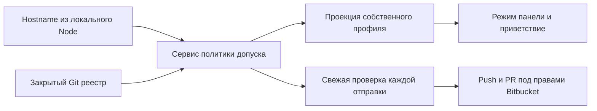

# Политика допуска по закрытому реестру рабочих мест

Дата: 28 октября 2026 года. Статус: спецификация нового поведения; схема ещё не внедрена в продукт.
Подтверждённые требования отделены от технических рекомендаций. Изменяется только политика допуска; предметные данные и процесс согласования сохраняются.

## 1 Подтверждённые требования

- Основной репозиторий приложения остаётся один. Дополнительный закрытый служебный репозиторий — явное исключение к D-110, не несколько рабочих пространств.
- В служебном репозитории находятся соответствия hostname → человек/роль и другие служебные настройки. Читать его могут только сотрудники УОР.
- При старте приложение получает hostname, проверяет запись и включает допущенным пользователям режим куратора; остальные работают как viewer.
- Перед каждым push hostname и допуск проверяются заново. Проверка только при входе недостаточна.
- Роли файла: `viewer`, `curator`, `chief`. В обычной панели `chief` имеет те же возможности подготовки, что `curator`.
- Реестр компьютеров и ролей, включая назначение главного УОР, изменяет только главный УОР. Кураторы только читают реестр.
- Это ответственность обслуживания реестра, а не новые действия обычной панели кураторов.
- Итоговый merge остаётся во внешнем Bitbucket. Назначение `chief` в файле не создаёт кнопку merge и не выдаёт серверные права.
- Локальные черновики при отсутствии связи сохраняются по D-098. Отправка требует свежей проверки допуска.
- Перенос рабочего места по D-107 не переносит допуск на другой ноутбук; роль проверяется заново.
- При старте показывается краткое приветствие «С возвращением, <имя>» во временном мини-окне.
- По D-123 имя и прикладная роль определяются только записью hostname в реестре. Привязку к учётной записи Bitbucket и проверку совпадения сейчас не вводим: назначение компьютера человеку ведёт главный УОР.

## 2 Граница доверия и рекомендации

Hostname — ключ конфигурации рабочего места, а не удостоверенная личность человека. `git user.name` и `git user.email` — метаданные коммита, не авторизация.
Реальные операции push и merge разрешает или отклоняет Bitbucket под учётной записью сотрудника; локальный файл не заменяет эти проверки.
Прежняя рекомендация сопоставлять профиль с Bitbucket account ID отклонена для текущего этапа по D-123. Поля аккаунта нет в реестре; совпадение профиля и аккаунта не является условием включения режима или отправки. Авторизация Git/Bitbucket при фактической операции остаётся самостоятельной проверкой внешней системы.
Рекомендуется сравнивать hostname после явно заданной нормализации регистра и пробелов; неоднозначные дубликаты запрещать, не выбирать первую строку.
Приложение использует только принятую ветку служебного репозитория. Путь файла и ветка задаются конфигурацией подключения; секреты не встраиваются в код.
Новые серверы, сложная IAM-система, сертификаты устройств и аппаратная аттестация не вводятся.

## 3 Формат реестра

Ниже предложенный формат и полностью синтетические данные. Имена hosts и людей не относятся к сотрудникам.

```json
{
  "schemaVersion": 1,
  "profiles": [
    {
      "hostname": "demo-chief-01", "displayName": "Анна Примерова",
      "personId": "11111111-1111-4111-8111-111111111111",
      "role": "chief", "enabled": true
    },
    {
      "hostname": "demo-curator-02", "displayName": "Иван Тестов",
      "personId": "22222222-2222-4222-8222-222222222222",
      "role": "curator", "enabled": true
    },
    {
      "hostname": "demo-disabled-03", "displayName": "Мария Примерова",
      "personId": "33333333-3333-4333-8333-333333333333",
      "role": "viewer", "enabled": false
    }
  ],
  "serviceSettings": {}
}
```

Проверяются версия схемы, обязательные поля, допустимая роль, Boolean `enabled` и отсутствие конфликтующих hostname.
`personId` обозначает человека, hostname — рабочее место. Имя отображения не является ключом или доказательством допуска.
В целевой схеме personId — UUIDv4 справочника людей (документ 16); это технический идентификатор, не аккаунт Bitbucket. Примеры ID синтетические.
Набор `serviceSettings` определяется отдельными схемами; произвольные настройки не отправляются в браузер.

## 4 Компоненты и точки проверки



Точки ниже относятся к существующему дереву `RM_UOR/src`; это места будущего изменения, а не уже подключённые компоненты новой схемы.

| Точка | Требуемая ответственность |
| --- | --- |
| `server/workspace/context.ts` | Подключить получение hostname, адаптер закрытого реестра и сервис политики. |
| `features/identity/role-service.ts` | Различать свежий допуск, собственный offline-профиль, отзыв и отсутствие проверки. |
| `features/identity/permissions.ts` | Проверять команды на серверной стороне; `chief` проецировать в обычные возможности куратора. |
| `features/identity/reader-projection.ts` | Не отдавать реестр; возвращать только допустимую собственную проекцию. |
| `features/publishing/application-publishing.ts` | Проверить допуск до `git.pushChanges` и любых последующих записей PR. |
| `features/publishing/git-cli-provider.ts` | Повторить проверку непосредственно перед фактическим push и каждым его повтором. |
| `features/workspace-maintenance/bundle-service.ts` | Исключить служебный реестр и переносимый допуск из обычного архива. |

## 5 Запуск и приветствие

1. Локальный Node получает hostname через стандартный `os.hostname()` из `node:os`, доступный в Node.js 22.16.0; отдельные команды Windows/macOS не нужны. Сервер не принимает hostname или роль из тела браузерного запроса как доказательство допуска.
2. Через личное подключение выполняется чтение актуальной принятой версии закрытого реестра. Читателю сервер не предоставляет его содержимое.
3. Проверяется схема, находится однозначная запись собственного hostname и определяется её состояние.
4. Активные `curator`/`chief` получают режим куратора; `viewer`, отсутствие записи или `enabled=false` не дают этого допуска.
5. При временной недоступности используется только ранее проверенный собственный профиль для локальных черновиков. Без такого профиля — просмотр без допуска к подготовке УОР.
6. Время и основание проверки видны отдельно от роли; недоступность не обозначается как подтверждённый отзыв.
7. Приветствие немодальное, не перехватывает фокус, закрывается вручную или через 5 секунд и не повторяется при каждом переходе.
8. Имя берётся только из собственного допустимого профиля и выводится как текст; без имени используется «С возвращением».
9. Приветствие не задерживает чтение общих данных и не служит подтверждением полномочий.

## 6 Отправка и обслуживание реестра

1. При намерении отправить пакет заново получить hostname и свежую принятую версию служебного файла; стартовая сессия и offline-кэш не заменяют этот шаг.
2. Убедиться, что запись hostname активна и её роль `curator` либо `chief`. Сопоставление с аккаунтом Bitbucket не выполняется.
3. Проверить доступ к целевому основному репозиторию, актуальное основание и целостность пакета по общему процессу публикации.
4. Непосредственно перед каждой попыткой push повторить проверку hostname и актуальной роли. Повтор после ошибки не использует прежнее разрешение.
5. При отказе проверки остановиться до сетевых записей: не вызывать push, создание/обновление PR или запись комментария. Черновик остаётся локальным.
6. При разрешении выполнить push под правами сотрудника; Bitbucket независимо применяет собственные ограничения. Перед каждой следующей записью PR, его комментарием или повтором операции сервис снова проверяет актуальный допуск. Разрешение не сохраняется как пропуск для всей очереди.

В служебном репозитории кураторы получают Bitbucket Read, главный УОР — Write и исключительное обслуживание реестра/защищённой ветки. Проверяются также унаследованные права проекта.
Управление доступом и защитой ветки выполняет владелец с необходимыми административными правами Bitbucket; роль `chief` в JSON сама этих прав не создаёт.
Кураторы не отправляют изменения служебного реестра через обычную панель. Для основного репозитория сохраняются отдельные права публикации предложений и внешнего merge владельцем.

## 7 Матрица отказов

| Ситуация | Локальная работа | Отправка |
| --- | --- | --- |
| Свежая активная запись `curator`/`chief` | Обычная панель куратора. | Допустима после остальных проверок и решения Bitbucket. |
| Нет записи, `viewer` или `enabled=false` | Просмотр; прежний допуск помечен отозванным. Черновики сохранены, редактирование УОР не разрешается. | Запрещена. |
| Подтверждённый отказ Read служебного repo в действующем Git-подключении | Не использовать прежний допуск; режим просмотра, черновики сохранены. Не путать с истёкшей аутентификацией. Отдельное сопоставление личности не выполняется. | Запрещена. |
| Нет сети, таймаут или истекла авторизация | Ранее проверенный собственный профиль позволяет локальные черновики; иначе просмотр. Показана причина неопределённости. | Запрещена до свежей проверки. |
| Повреждённая схема, дубликаты, неизвестная роль | Ошибка проверки, режим просмотра до исправления; действующие черновики сохранены. Предложение о таком поведении при ошибке схемы подлежит приёмке. | Запрещена. |
| Изменился hostname | Старый профиль неприменим; требуется новая проверка. | Запрещена до проверки. |
| Сменилось Git/Bitbucket-подключение при прежнем hostname | Имя и роль по записи hostname не меняются автоматически. | Свежая проверка реестра и реальная авторизация новой операции обязательны; совпадение аккаунта с профилем не проверяется. |
| Bitbucket отклонил фактический push/merge | Показать серверный отказ, сохранить пакет. | Обход через другой режим или общую учётную запись запрещён. |

## 8 Приватность кэша и перенос

Полный реестр не включается в основной Git, опубликованные предметные пакеты, reader API, журналы с обычной диагностикой или обычный архив рабочего места.
Чтение и разбор выполняются локальным серверным компонентом; frontend получает только собственные displayName, режим и состояние проверки, без списка других hosts/людей.
Для offline допуска рекомендуется минимальный собственный кэш: hostname, personId, роль, enabled, идентификаторы репозиториев и установки, ревизия реестра и время проверки. Кэш связан с этой установкой, репозиториями и hostname; аккаунт Bitbucket не является частью допуска по D-123. Полный реестр не нужен как кэш полномочий.
Кэш хранится в приватной локальной области; он не является самостоятельной авторизацией Bitbucket. Явный отзыв делает его непригодным для допуска и не удаляет историю или черновики.
После переноса архива профиль допуска проверяется заново на фактическом hostname. Архив не активирует прежние сессии или роль на новом ноутбуке.
Это правило действует и для восстановления SQLite-копии на прежнем ноутбуке: восстановленная запись о сессии сама не выдаёт допуск. Локальное хранилище политики отделяется от переносимых предметных данных.
Резервирование самого служебного репозитория — отдельная ответственность главного УОР; обычный перенос данных приложения его не распространяет.

## 9 План проверок и ожидаемые результаты

| Проверочный случай | Ожидаемое решение |
| --- | --- |
| Известный активный curator | Панель куратора, собственное имя; приветствие исчезает через 5 секунд. |
| Активный chief | Та же панель подготовки; отсутствует дополнительное действие merge. |
| Аккаунт Bitbucket не сопоставлен с профилем hostname | Отсутствие сопоставления не блокирует режим куратора; фактическую запись по-прежнему разрешает или отклоняет Bitbucket. |
| Неизвестный host или выключенная запись | Viewer; локально отклонённая отправка даёт 0 вызовов push и 0 записей PR. |
| После входа запись отключили | Следующая свежая проверка блокирует push: 0 сетевых записей, пакет не потерян. |
| После разрешённой попытки нужен повтор | Повторная проверка; при отзыве повторный push не вызывается. |
| Сбой сети с собственным кэшем/без него | Только локальный черновик/просмотр соответственно; отправка даёт 0 сетевых записей. |
| Дубликат hostname или повреждённый JSON | Явная ошибка; отправка даёт 0 сетевых записей, старые данные сохранены. |
| Перенос на другой hostname | Кэш не выдаёт допуск; требуются реестр и новая проверка. |
| Экспорт архива и reader API | Нет полного реестра, служебной копии repo, секретов и переносимых полномочий. |
| Bitbucket отказал после локального допуска | Сервер не принял изменений; попытка push могла состояться, PR после отказа не записывается. |

При реализации счётчики различают сетевое чтение проверки, попытку записи и принятую сервером мутацию. При локальном отказе попыток записи должно быть ноль.

## 10 Источники и статус проверки

[Node.js 22.16.0 os.hostname](https://nodejs.org/download/release/v22.16.0/docs/api/os.html#oshostname) возвращает hostname ОС. [Bitbucket repository permissions](https://confluence.atlassian.com/security/using-repository-permissions-1409092189.html) разделяют Read/Write/Admin; [branch permissions](https://confluence.atlassian.com/bitbucketserver/using-branch-permissions-776639807.html) дополнительно ограничивают действия над ветками. Возможности сверяются с фактической корпоративной редакцией.
Текущий код использует прежний локальный парольный реестр и механизм release-current. Они не подтверждают внедрение описанной политики и не должны стать обходом новой проверки допуска.
Адрес служебного репозитория и реальные профили ещё не предоставлены. Репозиторий не создавался, права Bitbucket не изменялись; JSON выше — пример будущего формата.
Выполнены чтение указанных точек кода и проверка официальных источников. Таблица выше — план проверок, не пройденные продуктовые тесты. Код не изменялся, продуктовые тесты не запускались.
